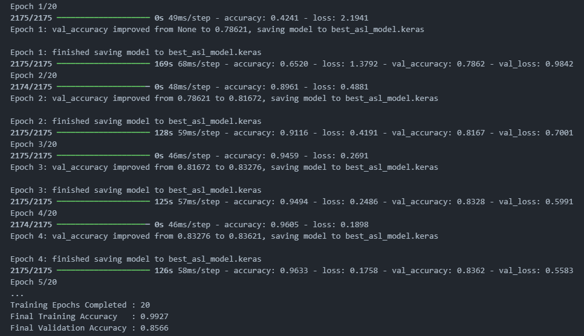
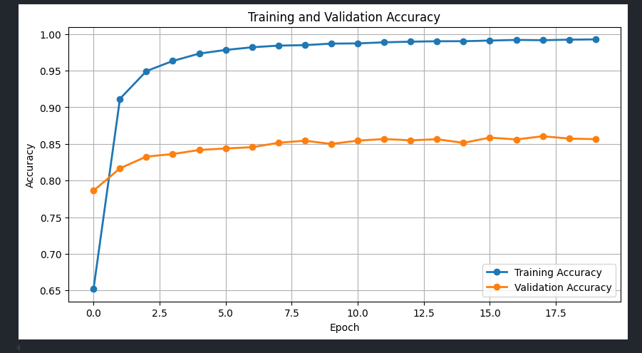
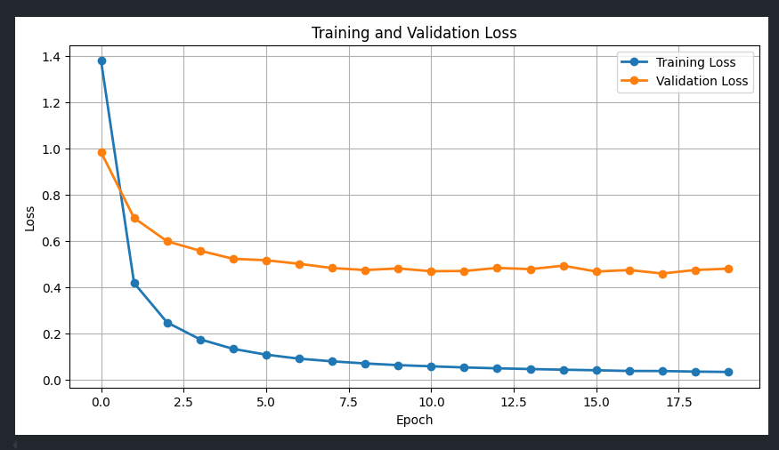
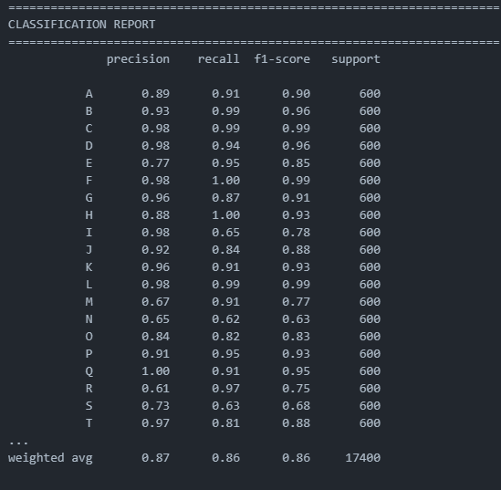
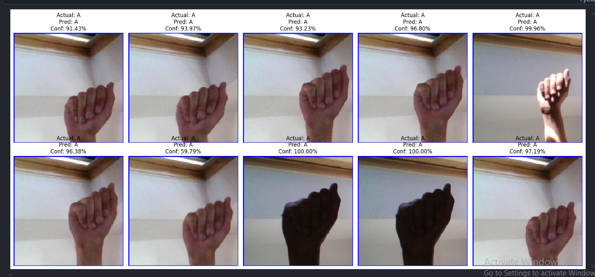
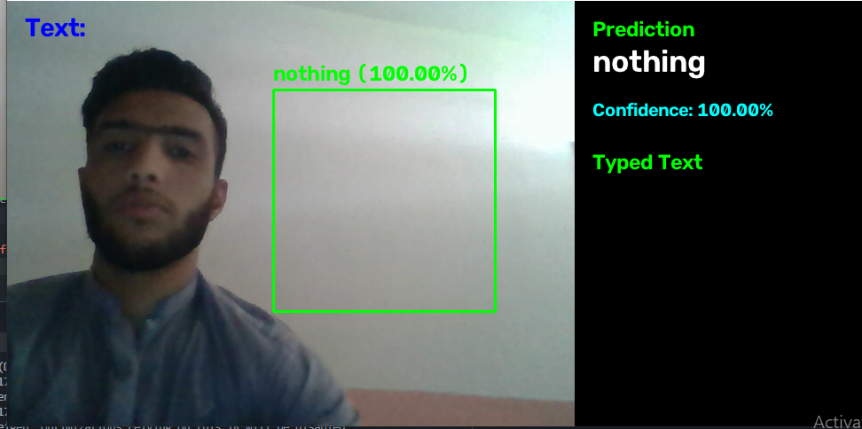
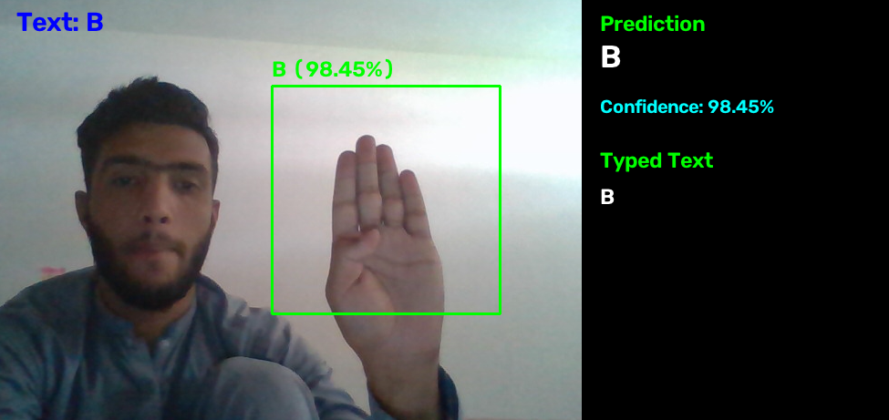
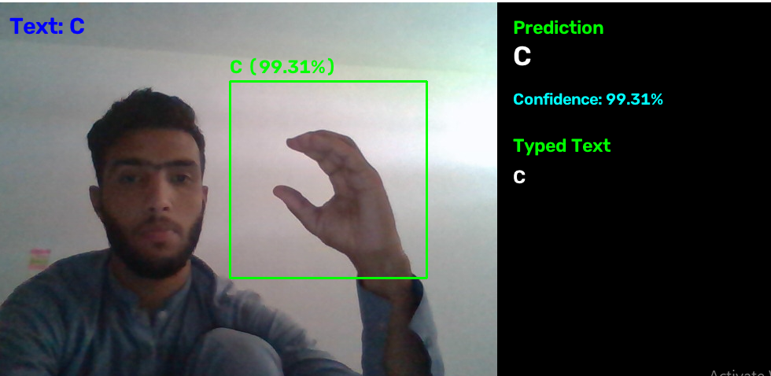
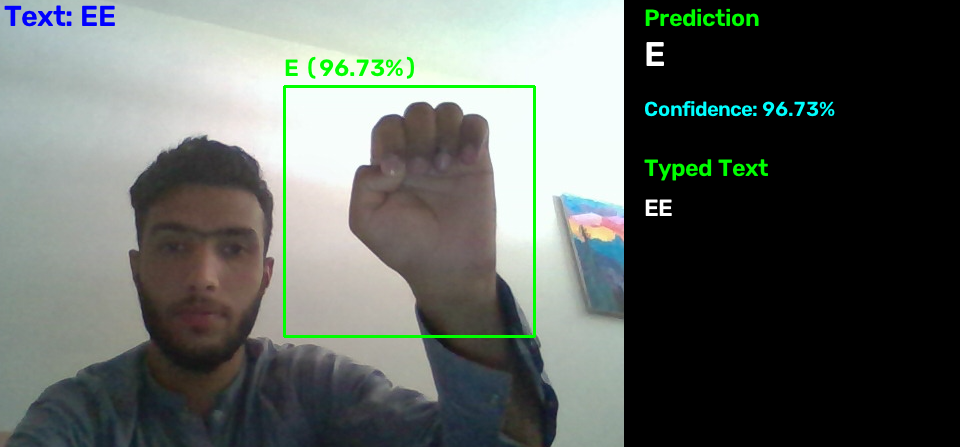

# 🤟 Real-Time American Sign Language Recognition Using Deep Learning

> A Deep Learning-based Computer Vision project that recognizes American Sign Language (ASL) hand gestures in real time using a webcam and converts them into readable text.

---

## 📌 Project Overview

This project presents a **Real-Time American Sign Language (ASL) Recognition System** developed using **Deep Learning** and **Computer Vision**. A Convolutional Neural Network (CNN) model is trained on the ASL Alphabet Dataset to recognize hand gestures. The trained model is then integrated with a webcam to perform live gesture recognition and generate text in real time.

The system aims to bridge communication gaps by providing an intelligent solution for recognizing sign language.

---

## ✨ Features

- ✅ Real-time ASL gesture recognition
- ✅ CNN-based Deep Learning model
- ✅ Live webcam integration
- ✅ Confidence score display
- ✅ Sentence generation
- ✅ Prediction panel
- ✅ Automatic text generation
- ✅ Fast and efficient prediction
- ✅ User-friendly interface

---

## 🛠️ Technologies Used

| Technology | Purpose |
|------------|---------|
| Python | Programming Language |
| TensorFlow / Keras | Deep Learning Framework |
| OpenCV | Computer Vision |
| NumPy | Numerical Computing |
| Matplotlib | Data Visualization |
| VS Code | Development Environment |
| Jupyter Notebook | Model Training |

---

## 📂 Project Structure

```text
ASL_Recognition_Project/
│
├── app.py
├── asl_model.keras
├── ASL_Alphabets.ipynb
├── README.md
└── requirements.txt
```

---

## 🧠 Deep Learning Model

- Model Type: Convolutional Neural Network (CNN)
- Framework: TensorFlow / Keras
- Dataset: ASL Alphabet Dataset
- Image Size: 224 × 224
- Prediction: Multi-Class Classification
- Output Classes:
  - A–Z
  - Space
  - Delete
  - Nothing

---

## 📸 Project Screenshots

### Model Training

> *()*

---

### Validation Prediction

> *()*
> *()*
> *()*
> *()*

---

### Real-Time Webcam Prediction

> *()*
> *()*
> *()*
> *()*
> *([!Predicted R](Screenshots/predicted_R.png))*
---

## ⚙️ Installation

Clone the repository.

```
git clone https://github.com/yourusername/ASL_Recognition_Project.git
```

Move into the project folder.

```bash
cd ASL_Recognition_Project
```

Install the required libraries.

```bash
pip install -r requirements.txt
```

---

## ▶️ Run the Project

Execute the following command.

```bash
python app.py
```

---

## 📊 Dataset

Dataset Used:

**ASL Alphabet Dataset**

https://www.kaggle.com/datasets/grassknoted/asl-alphabet

---

## 🚀 Future Improvements

- MediaPipe Hand Tracking
- Dynamic Gesture Recognition
- Text-to-Speech
- Speech-to-Text
- Web Deployment
- Android Application
- Higher Accuracy
- NLP-based Sentence Correction
- Multi-language Support

---

## 👨‍💻 Author

### Sohail Ahmed

**Data Scientist | AI Engineer**

🎓 BS Telecommunication Engineering

🏫 Hazara University

### Areas of Interest

- Artificial Intelligence
- Data Science
- Machine Learning
- Deep Learning
- Computer Vision

---

## 📜 License

This project is developed for educational and research purposes.

---

<div align="center">

# ⭐ If you found this project useful, consider giving it a star on GitHub!

### *"Artificial Intelligence is not just about building intelligent systems; it is about creating technologies that empower people and improve lives."*

**Made with ❤️ by Sohail Ahmed**

</div>